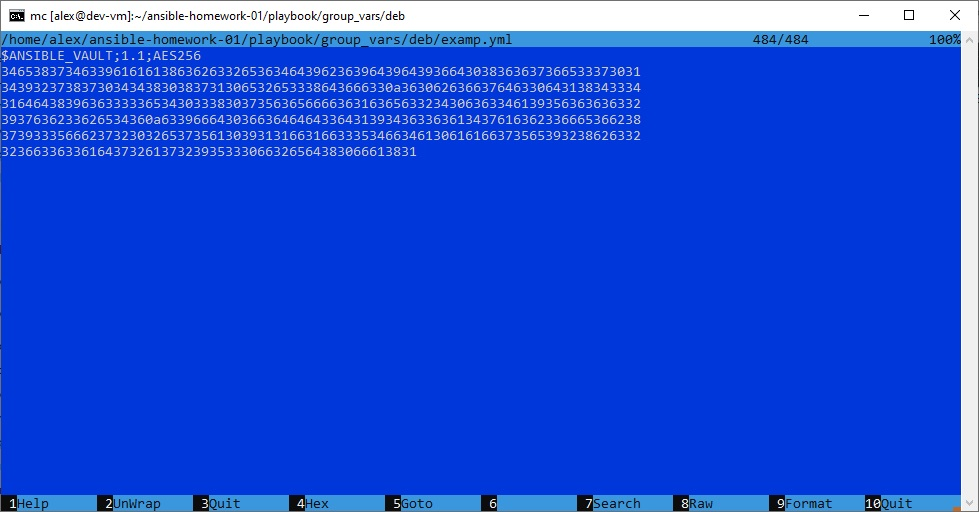
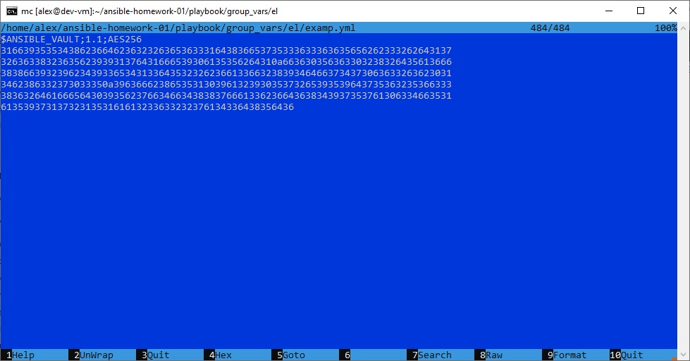
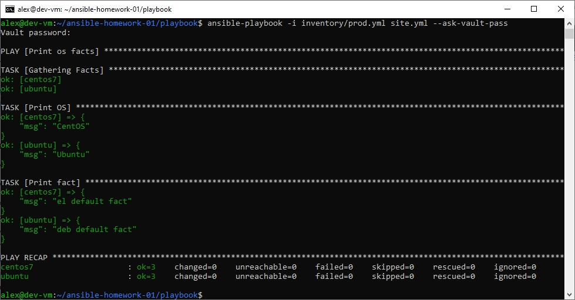
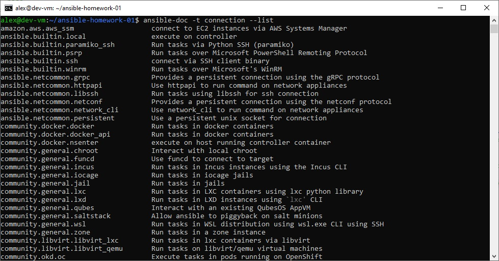
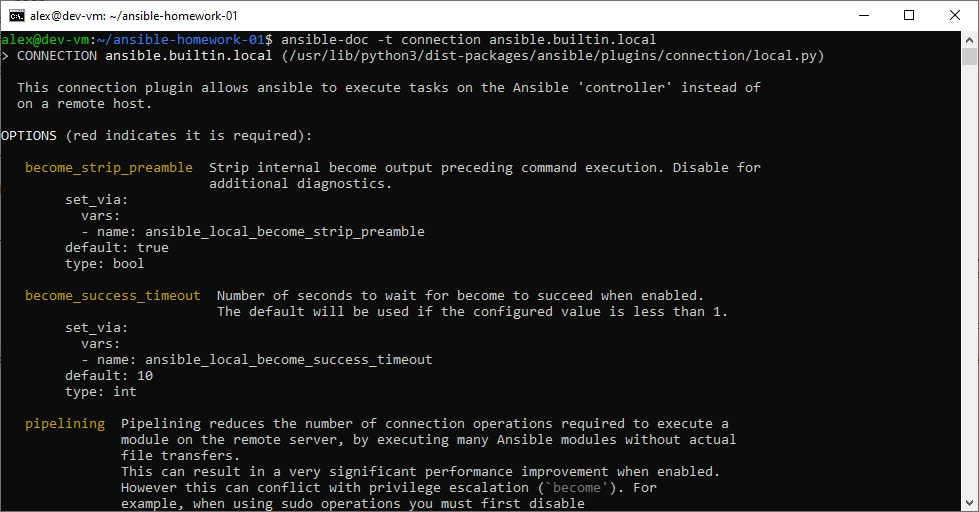

# Домашнее задание к занятию 1 «Введение в Ansible»

## Подготовка к выполнению

### 1. Установите Ansible версии 2.10 или выше.


  
### 2. Создайте свой публичный репозиторий на GitHub с произвольным именем. 

Создан **публичный** репозиторий: `https://github.com/akamsoft/ansible-homework-01`.

### 3. Скачайте [Playbook](./playbook/) из репозитория с домашним заданием и перенесите его в свой репозиторий.

Playbook из [`netology-code/mnt-homeworks/08-ansible-01-base/playbook`](https://github.com/netology-code/mnt-homeworks/tree/MNT-video/08-ansible-01-base/playbook) скопирован в папку `playbook/` репозитория.

## Основная часть

### 1. Попробуйте запустить playbook на окружении из `test.yml`, зафиксируйте значение, которое имеет факт `some_fact` для указанного хоста при выполнении playbook.

Запуск playbook на `test.yml`

Инвентарь `playbook/inventory/test.yml`:

```yaml
---
  inside:
    hosts:
      localhost:
        ansible_connection: local
        ansible_python_interpreter: /usr/bin/python3
```

Команда:

```bash
cd playbook
ansible-playbook -i inventory/test.yml site.yml
```

Вывод задачи `Print fact`:

```
TASK [Print fact] ***
ok: [localhost] => {
    "msg": 12
}
```

**Зафиксированное значение `some_fact` для хоста `localhost`: `12`.**

Значение задаётся в `playbook/group_vars/all/examp.yml`. Переменные из `group_vars/el` и `group_vars/deb` к хосту не применяются, так как в `test.yml` хост входит только в группу `inside` (и неявно `all`).


### 2. Найдите файл с переменными (group_vars), в котором задаётся найденное в первом пункте значение, и поменяйте его на `all default fact`.

Искомый файл — `playbook/group_vars/all/examp.yml`.

Было:

```yaml
---
  some_fact: 12
```

Стало:

```yaml
---
  some_fact: "all default fact"
```


После повторного запуска `ansible-playbook -i inventory/test.yml site.yml` задача `Print fact` выводит `"msg": "all default fact"`.


### 3. Воспользуйтесь подготовленным (используется `docker`) или создайте собственное окружение для проведения дальнейших испытаний.

Для испытаний подготовлены Docker-контейнеры. Поскольку CentOS 7 — EOL, использован собственный образ с Python 3.8 (совместим с Ansible из Debian 13); `ubuntu` — из готового образа `geerlingguy/docker-ubuntu2004-ansible`.

`Dockerfile.centos7`:

```dockerfile
FROM centos:7

# 1. Переключаем стандартные репозитории на vault.centos.org (CentOS 7 EOL)
RUN sed -i 's/mirrorlist/#mirrorlist/g' /etc/yum.repos.d/CentOS-*.repo && \
    sed -i 's|#baseurl=http://mirror.centos.org|baseurl=http://vault.centos.org|g' /etc/yum.repos.d/CentOS-*.repo

# 2. Устанавливаем SCL и Python 3.8
# Сначала ставим только метапакет SCL
RUN yum install -y centos-release-scl && \
    # 3. Теперь исправляем ВСЕ файлы репозиториев, включая появившиеся SCL
    sed -i 's/mirror.centos.org/vault.centos.org/g' /etc/yum.repos.d/*.repo && \
    sed -i 's/^#.*baseurl=http/baseurl=http/g' /etc/yum.repos.d/*.repo && \
    sed -i 's/^mirrorlist=http/#mirrorlist=http/g' /etc/yum.repos.d/*.repo && \
    # 4. Только после этого ставим Python 3.8
    yum install -y rh-python38 && \
    yum clean all

# 5. Делаем Python 3.8 интерпретатором по умолчанию для Ansible
RUN ln -sf /opt/rh/rh-python38/root/usr/bin/python3.8 /usr/bin/python3

CMD ["sleep", "infinity"]
```

`docker-compose.yml`:

```yaml
services:
  centos7:
    image: my-centos7-python38
    container_name: centos7
    restart: unless-stopped
    command: "sleep infinity"
  ubuntu:
    image: geerlingguy/docker-ubuntu2004-ansible
    container_name: ubuntu
    restart: unless-stopped
    command: "sleep infinity"
```

Запуск и проверка:

```bash
docker compose up -d
cd playbook
ansible -i inventory/prod.yml all -m ping
```


Оба хоста (`centos7`, `ubuntu`) отвечают `pong`.


### 4. Проведите запуск playbook на окружении из `prod.yml`. Зафиксируйте полученные значения `some_fact` для каждого из `managed host`.

Команда:

```bash
ansible-playbook -i inventory/prod.yml site.yml
```

Вывод задачи `Print fact`:

```
ok: [centos7] => { "msg": "el" }
ok: [ubuntu]  => { "msg": "deb" }
```

| Хост | Группа | `some_fact` | Источник |
|---|---|---|---|
| `centos7` | `el` | `el` | `group_vars/el/examp.yml` |
| `ubuntu` | `deb` | `deb` | `group_vars/deb/examp.yml` |

Переменные групп `el` и `deb` перекрывают `all default fact` — демонстрация приоритета групповых переменных над `all`.


### 5. Добавьте факты в `group_vars` каждой из групп хостов так, чтобы для `some_fact` получились значения: для `deb` — `deb default fact`, для `el` — `el default fact`.

- `playbook/group_vars/el/examp.yml` → `some_fact: "el default fact"`
- `playbook/group_vars/deb/examp.yml` → `some_fact: "deb default fact"`


### 6.  Повторите запуск playbook на окружении `prod.yml`. Убедитесь, что выдаются корректные значения для всех хостов.

```bash
ansible-playbook -i inventory/prod.yml site.yml
```

```
ok: [centos7] => { "msg": "el default fact" }
ok: [ubuntu]  => { "msg": "deb default fact" }
```


### 7. При помощи `ansible-vault` зашифруйте факты в `group_vars/deb` и `group_vars/el` с паролем `netology`.

Файлы `group_vars/deb/examp.yml` и `group_vars/el/examp.yml` зашифрованы с паролем `netology`:

```bash
ansible-vault encrypt playbook/group_vars/deb/examp.yml playbook/group_vars/el/examp.yml
```


Содержимое начинается с заголовка `$ANSIBLE_VAULT;1.1;AES256`, открытый текст `some_fact` в файлах отсутствует.




### 8. Запустите playbook на окружении `prod.yml`. При запуске `ansible` должен запросить у вас пароль. Убедитесь в работоспособности.

```bash
ansible-playbook -i inventory/prod.yml site.yml --ask-vault-pass
```

Ansible запрашивает пароль. После ввода `netology` значения снова расшифровываются и выводятся корректно.



### 9. Посмотрите при помощи `ansible-doc` список плагинов для подключения. Выберите подходящий для работы на `control node`.

```bash
ansible-doc -t connection --list
```

Список включает `ansible.builtin.local` (описание: `execute on controller`).

**Для работы на control node выбран `ansible.builtin.local`** — он выполняет задачи непосредственно на управляющей машине без сетевого подключения. Именно он используется в `inventory/test.yml` и группе `local` в `inventory/prod.yml`.





### 10. В `prod.yml` добавьте новую группу хостов с именем  `local`, в ней разместите localhost с необходимым типом подключения.

Итоговый `playbook/inventory/prod.yml`:

```yaml
---
  el:
    hosts:
      centos7:
        ansible_connection: docker
  deb:
    hosts:
      ubuntu:
        ansible_connection: docker
  local:
    hosts:
      localhost:
        ansible_connection: local
  ```

Проверка:

```bash
ansible-inventory -i inventory/prod.yml --graph
```

```
@all:
  |--@deb:
  |  |--ubuntu
  |--@el:
  |  |--centos7
  |--@local:
  |  |--localhost
  |--@ungrouped:
```


### 11. Запустите playbook на окружении `prod.yml`. При запуске `ansible` должен запросить у вас пароль. Убедитесь, что факты `some_fact` для каждого из хостов определены из верных `group_vars`.


### 12. Заполните `README.md` ответами на вопросы. Сделайте `git push` в ветку `master`. В ответе отправьте ссылку на ваш открытый репозиторий с изменённым `playbook` и заполненным `README.md`.
### 13. Предоставьте скриншоты результатов запуска команд.

## Необязательная часть

### 1. При помощи `ansible-vault` расшифруйте все зашифрованные файлы с переменными.
### 2. Зашифруйте отдельное значение `PaSSw0rd` для переменной `some_fact` паролем `netology`. Добавьте полученное значение в `group_vars/all/exmp.yml`.
### 3. Запустите `playbook`, убедитесь, что для нужных хостов применился новый `fact`.
### 4. Добавьте новую группу хостов `fedora`, самостоятельно придумайте для неё переменную. В качестве образа можно использовать [этот вариант](https://hub.docker.com/r/pycontribs/fedora).
### 5. Напишите скрипт на bash: автоматизируйте поднятие необходимых контейнеров, запуск ansible-playbook и остановку контейнеров.
### 6. Все изменения должны быть зафиксированы и отправлены в ваш личный репозиторий.

---

### Как оформить решение задания

Приложите ссылку на ваше решение в поле «Ссылка на решение» и нажмите «Отправить решение»
---
