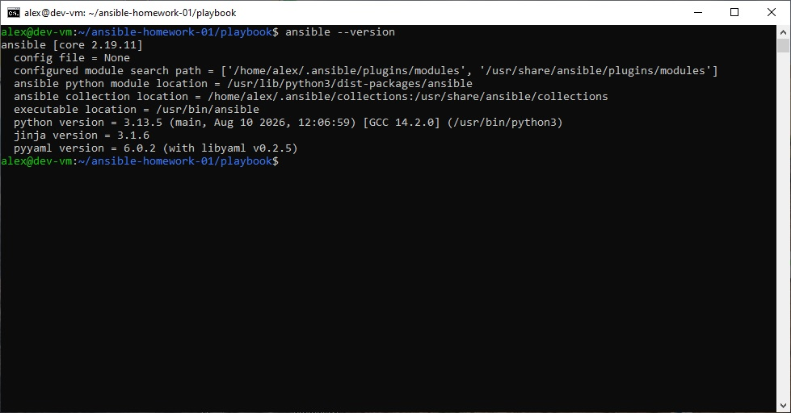
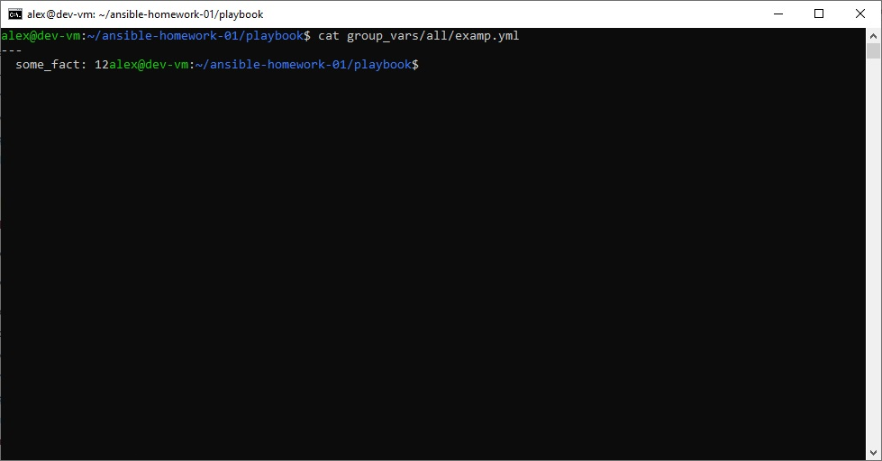
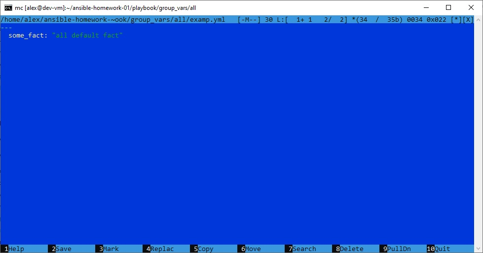
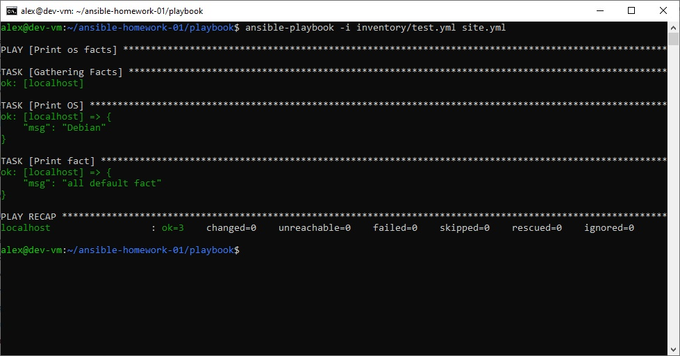
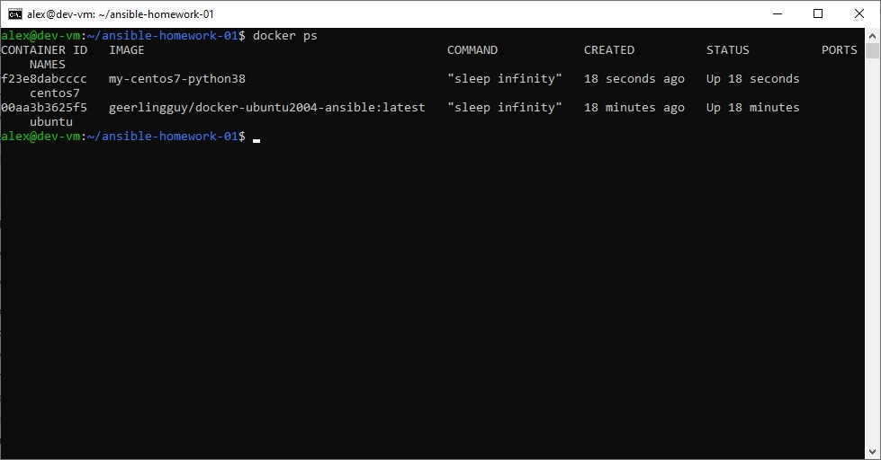
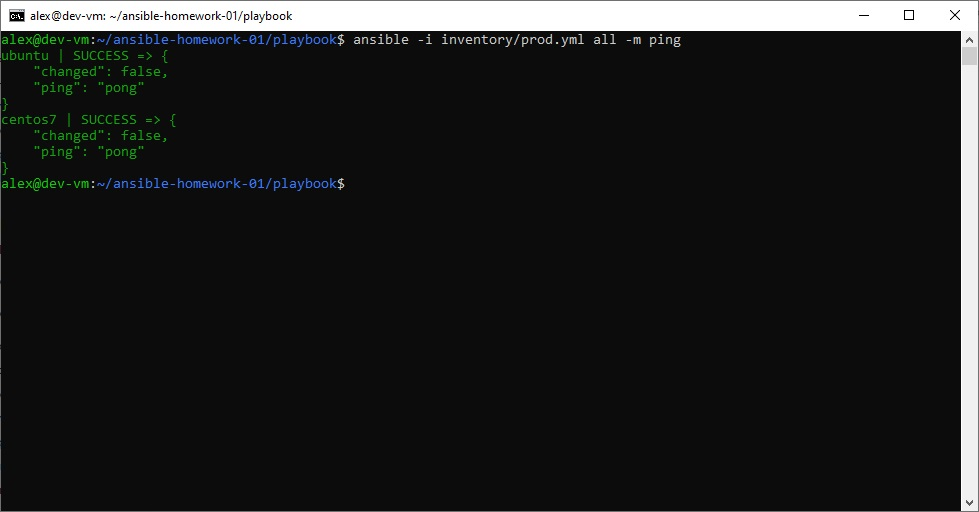
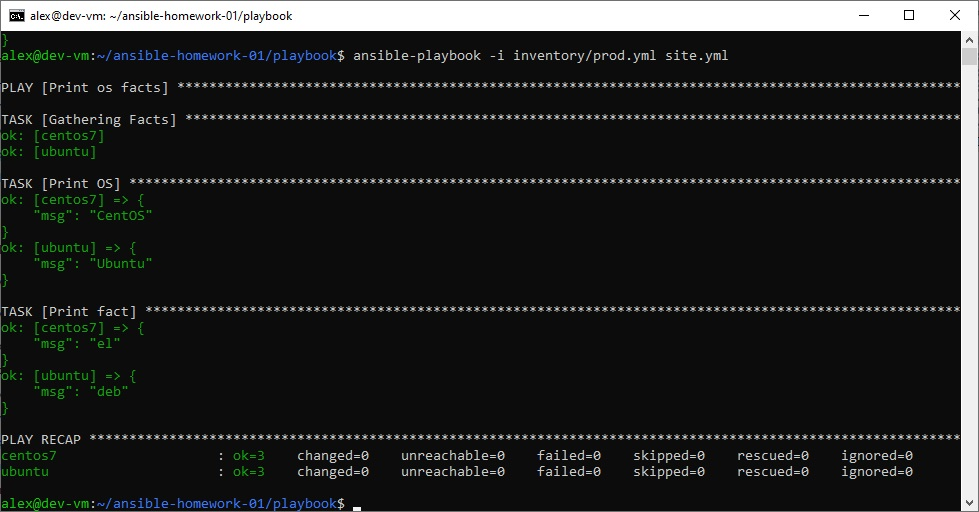
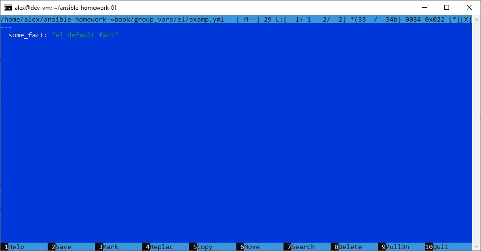
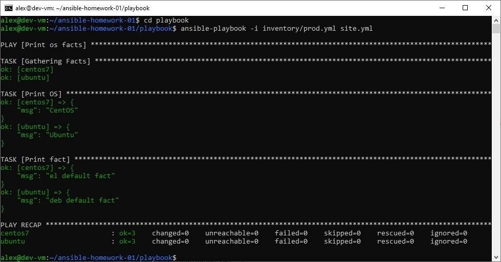
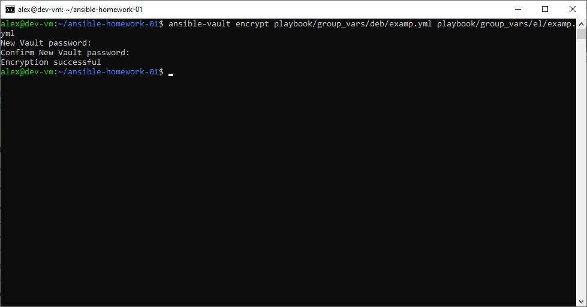

# Домашнее задание к занятию 1 «Введение в Ansible»

**Ссылка на репозиторий:** https://github.com/akamsoft/ansible-homework-01

## Подготовка к выполнению

1. **Ansible** установлен из репозитория Debian 13 командой:

   ```bash
   sudo apt update
   sudo apt install ansible -y
   ```

   Проверка версии:

   ```bash
   ansible --version
   ```

   Установленная версия `ansible-core` соответствует требованию (2.10+); фактический вывод — на скриншоте.

   

2. Создан **публичный** репозиторий: `https://github.com/akamsoft/ansible-homework-01`.

3. Playbook из [`netology-code/mnt-homeworks/08-ansible-01-base/playbook`](https://github.com/netology-code/mnt-homeworks/tree/MNT-video/08-ansible-01-base/playbook) скопирован в папку `playbook/` репозитория.

## Основная часть

### Пункт 1. Запуск playbook на `test.yml`

Инвентарь `playbook/inventory/test.yml`:

```yaml
---
  inside:
    hosts:
      localhost:
        ansible_connection: local
```

Команда:

```bash
cd playbook
ansible-playbook -i inventory/test.yml site.yml
```

Вывод задачи `Print fact`:

```
TASK [Print fact] ***
ok: [localhost] => {
    "msg": 12
}
```

**Зафиксированное значение `some_fact` для хоста `localhost`: `12`.**

Значение задаётся в `playbook/group_vars/all/examp.yml`. Переменные из `group_vars/el` и `group_vars/deb` к хосту не применяются, так как в `test.yml` хост входит только в группу `inside` (и неявно `all`).


### Пункт 2. Замена значения `some_fact`

Искомый файл — `playbook/group_vars/all/examp.yml`.

Было:

```yaml
---
  some_fact: 12
```

Стало:

```yaml
---
  some_fact: "all default fact"
```

После повторного запуска `ansible-playbook -i inventory/test.yml site.yml` задача `Print fact` выводит `"msg": "all default fact"`.



### Пункт 3. Docker-окружение

Для испытаний подготовлены Docker-контейнеры. Поскольку CentOS 7 — EOL, использован собственный образ с Python 3.8 (совместим с Ansible из Debian 13); `ubuntu` — из готового образа `geerlingguy/docker-ubuntu2004-ansible`.

`Dockerfile.centos7`:

```dockerfile
FROM centos:7

# Переключаем репозитории на vault.centos.org (CentOS 7 EOL)
RUN sed -i 's/mirrorlist/#mirrorlist/g' /etc/yum.repos.d/CentOS-*.repo && \
    sed -i 's|#baseurl=http://mirror.centos.org|baseurl=http://vault.centos.org|g' /etc/yum.repos.d/CentOS-*.repo

# Ставим SCL и Python 3.8
RUN yum install -y centos-release-scl && \
    sed -i 's/mirror.centos.org/vault.centos.org/g' /etc/yum.repos.d/*.repo && \
    sed -i 's/^#.*baseurl=http/baseurl=http/g' /etc/yum.repos.d/*.repo && \
    sed -i 's/^mirrorlist=http/#mirrorlist=http/g' /etc/yum.repos.d/*.repo && \
    yum install -y rh-python38 && \
    yum clean all

# Делаем Python 3.8 интерпретатором по умолчанию для Ansible
RUN ln -sf /opt/rh/rh-python38/root/usr/bin/python3.8 /usr/bin/python3

CMD ["sleep", "infinity"]
```

`docker-compose.yml`:

```yaml
services:
  centos7:
    image: my-centos7-python38
    container_name: centos7
    restart: unless-stopped
    command: "sleep infinity"
  ubuntu:
    image: geerlingguy/docker-ubuntu2004-ansible
    container_name: ubuntu
    restart: unless-stopped
    command: "sleep infinity"
  fedora:
    image: geerlingguy/docker-fedora39-ansible:latest
    container_name: fedora-01
    restart: unless-stopped
    command: "sleep infinity"
```

Запуск и проверка:

```bash
docker compose up -d
cd playbook
ansible -i inventory/prod.yml all -m ping
```

Оба хоста (`centos7`, `ubuntu`) отвечают `pong`.




### Пункт 4. Запуск playbook на `prod.yml`

Команда:

```bash
ansible-playbook -i inventory/prod.yml site.yml
```

Вывод задачи `Print fact`:

```
ok: [centos7] => { "msg": "el" }
ok: [ubuntu]  => { "msg": "deb" }
```

| Хост | Группа | `some_fact` | Источник |
|---|---|---|---|
| `centos7` | `el` | `el` | `group_vars/el/examp.yml` |
| `ubuntu` | `deb` | `deb` | `group_vars/deb/examp.yml` |

Переменные групп `el` и `deb` перекрывают `all default fact` — демонстрация приоритета групповых переменных над `all`.



### Пункт 5. Групповые переменные для `el` и `deb`

- `playbook/group_vars/el/examp.yml` → `some_fact: "el default fact"`
- `playbook/group_vars/deb/examp.yml` → `some_fact: "deb default fact"`

### Пункт 6. Повторный запуск на `prod.yml`

```bash
ansible-playbook -i inventory/prod.yml site.yml
```

```
ok: [centos7] => { "msg": "el default fact" }
ok: [ubuntu]  => { "msg": "deb default fact" }
```



### Пункт 7. Шифрование `ansible-vault`

Файлы `group_vars/deb/examp.yml` и `group_vars/el/examp.yml` зашифрованы с паролем `netology`:

```bash
ansible-vault encrypt playbook/group_vars/deb/examp.yml playbook/group_vars/el/examp.yml
```

Содержимое начинается с заголовка `$ANSIBLE_VAULT;1.1;AES256`, открытый текст `some_fact` в файлах отсутствует.



### Пункт 8. Запуск с расшифровкой

```bash
ansible-playbook -i inventory/prod.yml site.yml --ask-vault-pass
```

Ansible запрашивает пароль. После ввода `netology` значения снова расшифровываются и выводятся корректно.



### Пункт 9. Плагины подключения

```bash
ansible-doc -t connection --list
```

Список включает `ansible.builtin.local` (описание: `execute on controller`).

**Для работы на control node выбран `ansible.builtin.local`** — он выполняет задачи непосредственно на управляющей машине без сетевого подключения. Именно он используется в `inventory/test.yml` и группе `local` в `inventory/prod.yml`.


### Пункт 10. Добавление группы `local`

Итоговый `playbook/inventory/prod.yml`:

```yaml
---
  el:
    hosts:
      centos7:
        ansible_connection: docker
  deb:
    hosts:
      ubuntu:
        ansible_connection: docker
  local:
    hosts:
      localhost:
        ansible_connection: local
  fedora:
    hosts:
      fedora-01:
        ansible_connection: docker
```

Проверка:

```bash
ansible-inventory -i inventory/prod.yml --graph
```

```
@all:
  |--@deb:
  |  |--ubuntu
  |--@el:
  |  |--centos7
  |--@local:
  |  |--localhost
  |--@fedora:
  |  |--fedora-01
  |--@ungrouped:
```



### Пункт 11. Запуск playbook на `prod.yml` с группой `local`

```bash
ansible-playbook -i inventory/prod.yml site.yml --ask-vault-pass
```

Пароль — `netology`. Результат:

| Хост | Группа | `some_fact` | Источник |
|---|---|---|---|
| `centos7` | `el` | `el default fact` | `group_vars/el/examp.yml` |
| `ubuntu` | `deb` | `deb default fact` | `group_vars/deb/examp.yml` |
| `localhost` | `local` | `all default fact` | `group_vars/all/examp.yml` |

Для группы `local` своего `group_vars/local/` нет, поэтому применяется значение из `all`. Все факты определены из верных `group_vars`.



### Пункт 12. README.md и git push

README.md заполнен (этот файл). Изменения отправлены в ветку `main`:

```bash
git add .
git commit -m "Complete homework 1: main and optional parts"
git push origin main
```

### Пункт 13. Скриншоты

Скриншоты запуска команд приложены в папке `images/`.

## Необязательная часть

### 1. Расшифровка файлов с переменными

```bash
ansible-vault decrypt playbook/group_vars/deb/examp.yml playbook/group_vars/el/examp.yml
```

Пароль — `netology`. Файлы возвращены в открытый вид.

### 2. Шифрование отдельного значения `PaSSw0rd`

```bash
ansible-vault encrypt_string 'PaSSw0rd' --name 'some_fact'
```

Пароль — `netology`. Полученный блок вида `some_fact: !vault |` вставлен в `playbook/group_vars/all/examp.yml` вместо `some_fact: "all default fact"`:

```yaml
---
  some_fact: !vault |
            $ANSIBLE_VAULT;1.1;AES256
            ...
```

### 3. Запуск playbook

```bash
ansible-playbook -i inventory/prod.yml site.yml --ask-vault-pass
```

Пароль — `netology`. Значение `PaSSw0rd` применилось к `localhost` (группа `local`) и `fedora-01` (группа `fedora`), у которых нет своих переопределённых `some_fact` в `group_vars`. Для `centos7`/`ubuntu` продолжают действовать `el default fact` / `deb default fact`.

### 4. Новая группа `fedora`

Добавлена в `inventory/prod.yml` (см. п. 10). Хост — `fedora-01`, тип подключения — `docker`. Имя `fedora-01` выбрано вместо `fedora`, чтобы избежать предупреждения `Found both group and host with same name: fedora`.

Создан `playbook/group_vars/fedora/examp.yml`:

```yaml
---
  my_custom_fact: "value for fedora"
```

Чтобы переменная была видна в выводе playbook, в `playbook/site.yml` добавлена задача:

```yaml
      - name: Print custom fact
        debug:
          msg: "{{ my_custom_fact | default('not set') }}"
```

Для `fedora-01` выводится `value for fedora`, для остальных хостов — `not set` (переменная не задана, срабатывает `default`).

Итоговый `playbook/site.yml`:

```yaml
---
  - name: Print os facts
    hosts: all
    tasks:
      - name: Print OS
        debug:
          msg: "{{ ansible_distribution }}"
      - name: Print fact
        debug:
          msg: "{{ some_fact }}"
      - name: Print custom fact
        debug:
          msg: "{{ my_custom_fact | default('not set') }}"
```

### 5. Bash-скрипт автоматизации

`run_homework.sh` — поднимает контейнеры, запускает playbook, гарантированно останавливает контейнеры через `trap` даже при ошибке:

```bash
#!/bin/bash
set -e

cd "$(dirname "$0")"

cleanup() {
    echo "=== Остановка и удаление контейнеров ==="
    docker compose down
}
trap cleanup EXIT

echo "=== Запуск контейнеров ==="
docker compose up -d

echo "=== Ожидание готовности контейнеров ==="
sleep 3

echo "=== Запуск Ansible playbook ==="
cd playbook
# Приглашение Vault password: — введите netology и нажмите Enter.
# Символы при вводе не отображаются, это нормально.
ansible-playbook -i inventory/prod.yml site.yml --ask-vault-pass

echo "=== Готово ==="
```

Запуск:

```bash
chmod +x run_homework.sh
./run_homework.sh
```

На приглашении `Vault password:` вводится `netology`. В конце скрипт останавливает и удаляет контейнеры (даже если playbook завершился с ошибкой — благодаря `trap cleanup EXIT`).

### 6. Фиксация изменений

Все изменения закоммичены и отправлены в `main`:

```bash
git add .
git commit -m "Complete optional part: vault single value, fedora group, automation script"
git push origin main
```

## Структура репозитория

```
ansible-homework-01/
├── Dockerfile.centos7
├── docker-compose.yml
├── README.md
├── run_homework.sh
└── playbook/
    ├── site.yml                    (Print OS / Print fact / Print custom fact)
    ├── group_vars/
    │   ├── all/examp.yml           (some_fact — зашифрован vault: PaSSw0rd)
    │   ├── deb/examp.yml           (some_fact: "deb default fact")
    │   ├── el/examp.yml            (some_fact: "el default fact")
    │   └── fedora/examp.yml        (my_custom_fact: "value for fedora")
    └── inventory/
        ├── prod.yml                (el, deb, local, fedora)
        └── test.yml                (inside → localhost)
```

## Ссылка на репозиторий

**https://github.com/akamsoft/ansible-homework-01**
